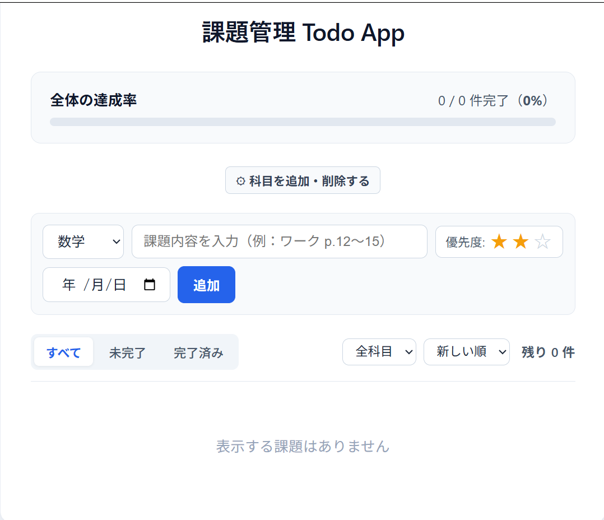
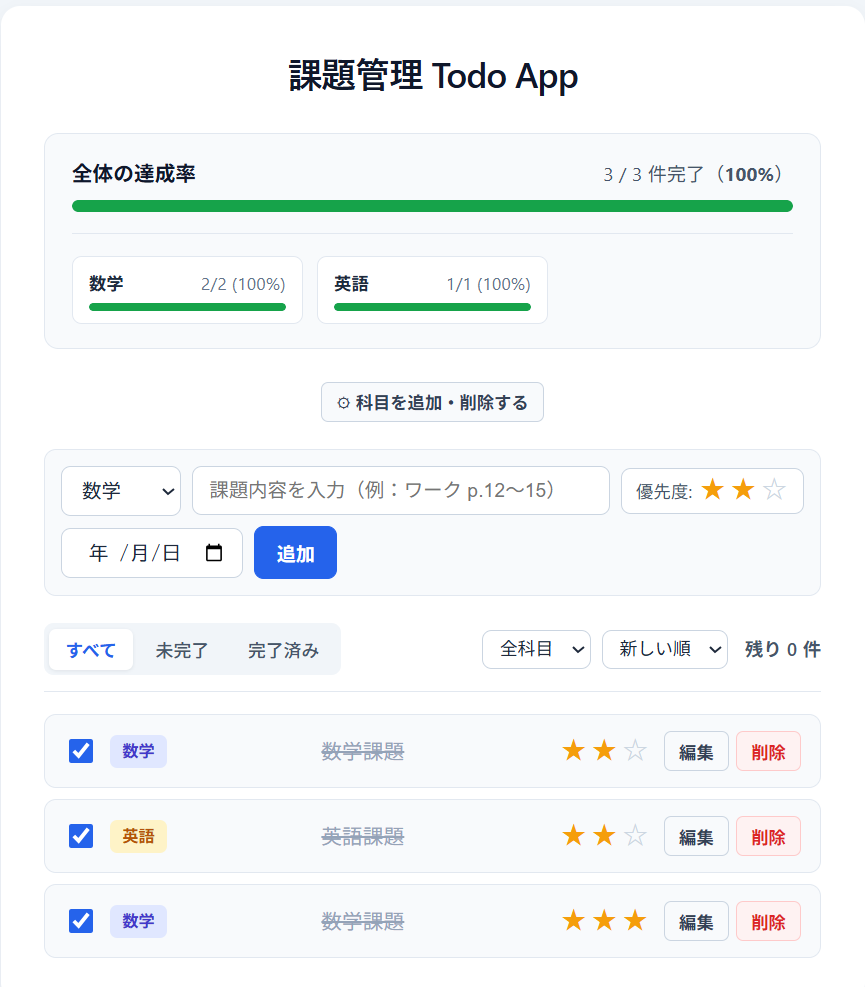
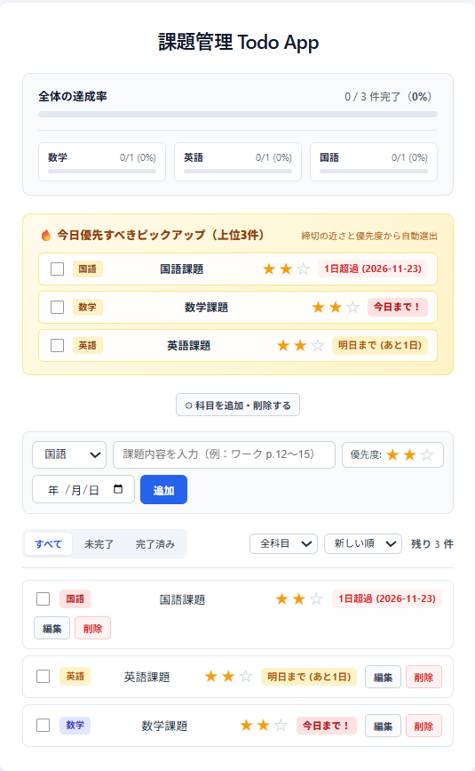
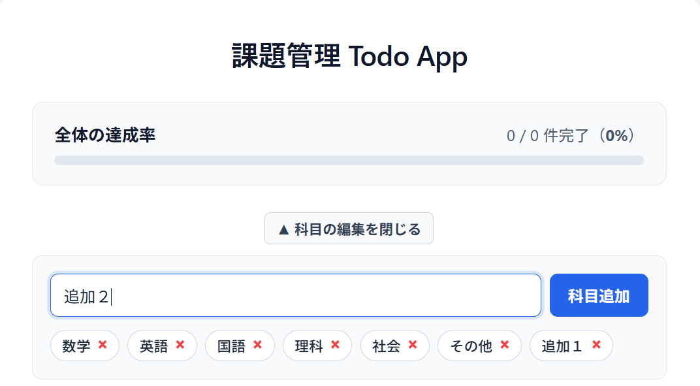

# 締切と科目別進捗を可視化する学習タスク管理アプリ

**公開URL (GitHub Pages):** https://SakyoK.github.io/todoapp/



## 1. コンセプトと開発の背景

日々の学習や提出物の管理において、一般的な汎用 Todo アプリを使っていた際に感じた以下の悩みを解決するために開発しました。

* **「どの科目の課題がどれだけ残っているか」が直感的に分からない**
  リストが1列に並ぶだけのアプリでは、特定の科目に未着手タスクが溜まっていても気づきにくい問題がありました。
* **「今日どれから手を付けるべきか」の判断に毎回時間がかかる**
  期限日と重要度がバラバラなタスクの中から、その日最優先で取り組むべきものを毎回頭の中で並べ替える負担がありました。

そこで、**「科目ごとの達成率の可視化」** と **「締切の緊急度 × 星評価優先度による自動ピックアップ」** を組み合わせ、開いた瞬間に今日やるべき行動が明確になる学習特化型のタスク管理アプリとして設計しました。

---

## 2. 主な機能

### ① 全体＆科目別のリアルタイム進捗ダッシュボード
* 全体の達成率だけでなく、タスクが登録されている**科目ごとの完了件数・達成率・プログレスバー**を自動集計して表示します。
* 達成率が 100% になった科目はバーがグリーンに変化し、完了の達成感を視覚的に得られるようにしました。



### ② 「今日優先すべきピックアップ（上位3件）」の自動選出
* 未完了タスクの中から、**「締切の近さ（3日以内・当日・超過）」**と**「3段階の星評価優先度」**を複合的にスコアリングし、今すぐ着手すべき上位3件を上部にハイライト表示します。
* ピックアップカード上から直接完了チェックを入れることができ、完了すると次の優先タスクが自動で繰り上がります。

### ③ 締切カウントダウンバッジと期限切れアラート
* 単なる日付（`YYYY-MM-DD`）の羅列ではなく、今日との差分を自動計算し、**「今日まで！」「明日まで（あと1日）」「あと3日」「○日超過」**といった直感的なステータスバッジに変換して表示します。



### ④ 科目のカスタム追加・削除と自動カラー割り当て
* 初期科目のほか、受講科目や資格勉強に合わせて画面上から自由に科目を追加・削除できます。
* 新しく追加した科目名にも、文字列ハッシュから自動でパステルカラーのバッジ色を割り当てる仕組みを実装しました。



### ⑤ インライン編集・絞り込み・データ永続化
* **インライン編集**: タイトルのダブルクリックまたは「編集」ボタンから、科目・内容・優先度・期限日をその場で変更できます（`Enter` で保存、`Esc` でキャンセル）。
* **多角的な絞り込み＆並び替え**: ステータス（すべて／未完了／完了済み）× 科目別フィルター × 並び替え（新しい順／優先度順／期限日順）を組み合わせて表示できます。
* **自動保存とレスポンシブ対応**: カスタムフック `useLocalStorage` により、タスクデータと追加したカスタム科目の両方をブラウザに自動保存します。スマートフォン幅でも崩れないレスポンシブデザインに対応しています。


---

## 3. 設計・実装で工夫したポイント

1. **責務を明確に分けたコンポーネント設計と状態のコロケーション**
   * `App.tsx` にロジックを集中させず、ダッシュボード（`ProgressDashboard`）、ピックアップ（`TodayFocusCard`）、科目管理（`SubjectManager`）、入力フォーム（`TodoForm`）、行アイテム（`TodoItem`）へ分割しました。
   * 編集モードの開閉状態や入力途中のテキストなど、特定の部品内で完結する State は子コンポーネント側に配置し、不要な再レンダリングとバグを防いでいます。
2. **純粋関数（Pure Function）による日付計算と優先度判定の分離**
   * タイムゾーンのズレによる「1日ズレ」を防ぐ日付差分計算や、緊急度・優先度の並び替えロジックを `src/utils/todoHelpers.ts` に切り出し、UI 表示と計算ロジックを分離しました。
3. **派生データ（Derived State）を持たない設計**
   * 絞り込み結果のリストや科目ごとの達成率を個別の `useState` で二重管理せず、元の `todos` 配列から描画時に計算して導出することで、データの不整合が起きない構造にしています。

---

## 4. 使用技術

| カテゴリ | 技術・ライブラリ |
| :--- | :--- |
| フロントエンド | React 19 / TypeScript 6 |
| ビルドツール | Vite 8 |
| スタイリング | CSS3（CSS Grid / Flexbox / レスポンシブ対応） |
| データ永続化 | Web Storage API (`localStorage`) |
| デプロイ | GitHub Pages (`gh-pages`) |

---

## 5. ディレクトリ構成

```text
src/
├── components/
│   ├── ProgressDashboard.tsx  # 全体・科目別の達成率ダッシュボード
│   ├── TodayFocusCard.tsx     # 今日優先すべき上位3件の自動ピックアップ
│   ├── SubjectManager.tsx     # 科目の追加・削除パネル
│   ├── TodoForm.tsx           # 新規タスク登録フォーム
│   ├── TodoFilter.tsx         # ステータス・科目絞り込み＆並び替えバー
│   ├── TodoItem.tsx           # タスク行（表示・チェック・インライン編集・削除）
│   └── StarRating.tsx         # 3段階の星評価コンポーネント
├── hooks/
│   └── useLocalStorage.ts     # localStorage 同期用カスタムフック
├── utils/
│   └── todoHelpers.ts         # 期限カウントダウン計算・優先度抽出ロジック
├── types/
│   └── todo.ts                # アプリ全体の型定義
├── App.tsx
└── App.css
```
開発期間: 2026.11.01 ~ 2026.11.18 (約30時間)